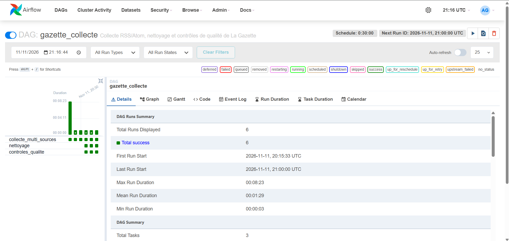

# Orchestration Airflow

Le DAG [`airflow/dags/gazette_collect.py`](../airflow/dags/gazette_collect.py) lance `collect_once` toutes les 30 minutes. Le service `app` du profil local est désactivé dans ce mode afin d'éviter une double collecte.

Pour démarrer l'orchestrateur en local :

```powershell
docker compose --profile airflow up --build
```

Puis ouvrir <http://localhost:8080> avec `admin` / `admin`. Le DAG est configuré avec `catchup=False` et `max_active_runs=1` : une exécution manquée n'est pas rejouée automatiquement et deux collectes ne se chevauchent pas.

Les volumes partagés conservent la base SQLite dans `data/` et les items bruts dans `articles_bruts/`. Les identifiants fournis sont uniquement destinés au développement local et doivent être remplacés avant toute mise en production.

## Enchaînement des tâches

Depuis le TD 4, chaque passage du DAG `gazette_collecte` enchaîne trois tâches :

1. `collecte_multi_sources` : lit toutes les sources actives de `sources.csv` ;
2. `nettoyage` : alimente `articles_propres` et `rejets` (voir [qualite.md](qualite.md)) ;
3. `controles_qualite` : vérifie les contrôles de qualité, exporte les métriques, écrit le rapport du jour et alerte sur Discord si un contrôle passe en échec.

`nettoyage` et `controles_qualite` tournent même si la collecte a échoué (`trigger_rule="all_done"`), pour que l'équipe soit prévenue.

## Preuve : la collecte tourne seule

Le 11 novembre 2026 à 21 h 16 UTC : 6 passages, 6 réussites, dont les passages lancés automatiquement par le planning toutes les 30 minutes (20 h 30, 21 h 00), et les trois tâches en vert à chaque passage depuis l'ajout du nettoyage.


