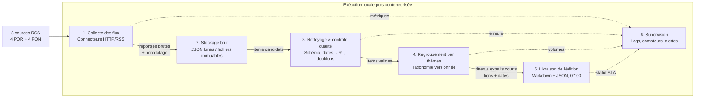

# Schéma d'architecture - La Gazette

**Responsable du dépôt :** Iliasse Mouradi (`ilya32e`)

## Contrats de données

- **Entrée RSS** : `source`, `source_type`, `title`, `summary`, `published_at`, `url`.
- **Item normalisé** : mêmes champs, plus `canonical_url`, `fetched_at`, `content_hash`, `topic`, `quality_status`.
- **Édition** : `edition_date`, `generated_at`, puis une liste de thèmes et d'items contenant seulement `source`, `title`, `excerpt`, `published_at`, `url`.

Le texte intégral ne traverse pas le pipeline et n'est pas stocké. Les flux bruts sont conservés pour permettre un audit et un rejeu, avec une durée de rétention à fixer avant la mise en production.

## Déclenchement et erreurs

Un déclenchement planifié démarre la collecte avant 7 h. Chaque source est isolée : un échec de connexion est journalisé et ne bloque pas les autres sources. L'édition est publiée avec un statut dégradé si le seuil minimal de sources valides est atteint ; sinon, la livraison échoue et une alerte est émise.
